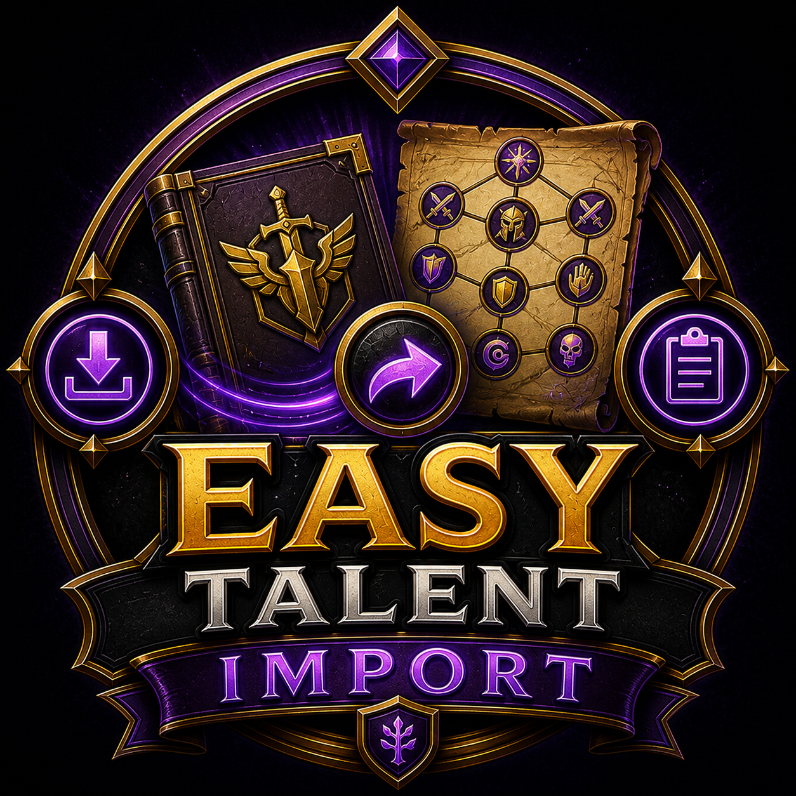

# EasyTalentImport

EasyTalentImport is a lightweight World of Warcraft addon that lets you import
a talent build into the currently selected loadout. Blizzard's default import
creates a new loadout every time; this addon can update an existing loadout
such as `M+` instead.

## Usage

1. Open the talent window.
2. Select the loadout you want to update.
3. Choose **Import** from the loadout dropdown.
4. Paste a talent import string.
5. Keep **Import into current loadout** checked and click **Import**.
6. Review the changes and click **Apply Changes**.

The final click remains manual because programmatically committing talent
changes can taint Blizzard's protected talent UI.

## Features

- Updates the selected loadout instead of creating a new one.
- Uses Blizzard's existing import window.
- Validates the specialization, serialization version, and talent tree hash.
- Has no libraries, saved variables, or configuration panel.

## Installation

Copy the `EasyTalentImport` folder to:

`World of Warcraft/_retail_/Interface/AddOns/`

The final structure should contain:

`Interface/AddOns/EasyTalentImport/EasyTalentImport.toc`

## Credits

The import behavior was isolated and adapted from the
`importIntoCurrentLoadout` module of TalentTreeTweaks by Numy.
